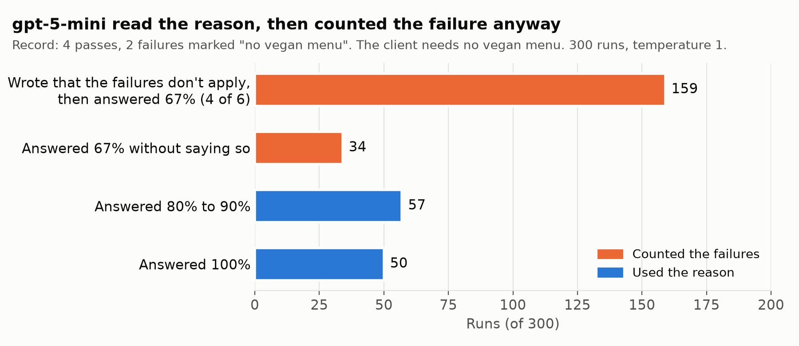
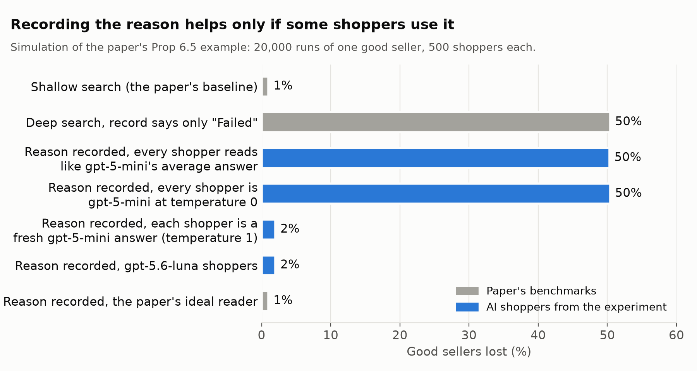

# Do AI shopping agents read why a seller failed?

**Question.** When a seller's record says why a past check failed, does an AI shopping agent use that reason, or does it just count the failures?

**How I tested it.** I showed gpt-5-mini a caterer's record of 4 passes and 2 failures and asked for the chance the caterer would suit a client. Only the two failure lines changed: plain `Failed`, `Failed (reason: no vegan menu)`, or deleted as a clean-record control. Then I fed its answers into a simulation of a 2026 theory paper's market ([Lucier et al.](https://arxiv.org/abs/2603.25893)) and ran a live market of gpt-5-mini shoppers.

## Key findings

- **gpt-5-mini read the reason, then counted the failure anyway.** The client needed no vegan menu. In 159 of 300 runs, the model wrote that the "no vegan menu" failures didn't apply, then gave the plain pass rate of 67% (4 of 6). Only 107 of 300 runs used the reason. With the failures deleted, it said 90 to 95%.
- **It ignored reasons that did apply, too.** For a vegan client, the same record got 67% in 30 of 30 runs. The right answer is close to 0.
- **In the simulation, recording the reason cut good sellers lost from 50% to 2%, but only because answers varied.** The 2% assumes each shopper is a fresh gpt-5-mini answer at temperature 1. If every shopper answers alike (the average answer, or temperature 0), 50% are still lost.

Agent `gpt-5-mini` ran at temperature 1, and the grader `gpt-5-mini` at temperature 0. There were 1,660 agent calls on 2026-11-02 and 2026-11-03. This is a small study with one model family (OpenAI). The [results table](#results) gives the runs for each test.



## Method

### The paper it builds on

Lucier, B., Immorlica, N., Mobius, M., Slivkins, A., Goldstein, D. G., Hofman, J. M., Jaffe, S., and Rothschild, D. M. (2026). *Agentic Markets: Equilibrium Effects of Improving Consumer Search.* [arXiv:2603.25893](https://arxiv.org/abs/2603.25893).

In the paper, AI agents send inquiries to businesses for shoppers. I tested two of its assumptions about how shoppers use information:

1. **Search.** Shoppers weigh the cost of an inquiry against the chance a business can take the job. This is the Weitzman index behind Theorem 6.1.
2. **Reading the record.** With deeper search, a good business can be lost: once its record looks bad enough, no arriving shopper inspects it again (Proposition 5.1). The paper's fix is a transcript that records why each check failed (Theorem 6.6). A shopper whose client doesn't share the failed need should discount that failure.

I built this for a class presentation in CIS 7000 (Machine Learning Ecosystems) at Penn, Fall 2026. It is my own solo work.

### Models

| Role | Model | Temperature |
|---|---|---|
| Agent (every test) | `gpt-5-mini` | 1 |
| Second agent (30-run tests) | `gpt-5.6-luna` | 1 |
| Grader (reads the number out of each reply) | `gpt-5-mini` | 0 |

These are the API model names. The run files don't record a dated snapshot. I planned the second model to come from another company, but my Anthropic and Google keys were rejected on the run day, so it is OpenAI's `gpt-5.6-luna`. I checked every grade in the 10-, 30- and 300-run tests against the number on the first line of its reply (the last line in the "reason first" format). All of them matched. Model calls ran through [AIBO](https://github.com/wharton-generative-ai-labs/AIBO), Wharton Generative AI Labs' experiment runner.

### Test 1: Does the agent read the reason?

The agent is booking a caterer for a client's Saturday company dinner for 80 guests. It sees six recent inquiries to one caterer and gives the chance, from 0 to 100, that the caterer will meet the client's needs. Only lines 2 and 5 of the record change:

| Condition | Lines 2 and 5 | Client's dietary needs |
|---|---|---|
| Plain (control) | `Failed` | none |
| Doesn't apply | `Failed (reason: no vegan menu)` | none |
| Clean record (control) | removed, so the record reads 4 of 4 passed | none |
| Applies to anyone | `Failed (reason: never replied to the inquiry)` | none |
| Plain, vegan client | `Failed` | vegan menu required |
| No vegan menu, vegan client | `Failed (reason: no vegan menu)` | vegan menu required |

**Reason-use index** = (Doesn't apply − Plain) / (Clean − Plain). A score of 0 means the agent counted the failures as if no reason were given. A score of 1 means it treated them as irrelevant, like the clean record. A "reason first" version asks for the one-sentence explanation before the number. The full prompts are in [prompts/](prompts/).

Runs per condition: 10 in the pilot (first four conditions), then 30 for each model, then 300 for the Plain and Doesn't apply records (gpt-5-mini only).

### Test 2: Does the agent search the way the theory says?

The client's event is worth $100. Alder's food is great 95% of the time, costs $40, and Alder can take the event 20% of the time. Birch's food is great 70% of the time, costs $30, and Birch can take the event 80% of the time. The agent contacts caterers one at a time. The index says to contact Alder first when an inquiry costs less than $4, and Birch first when it costs more. Each inquiry cost $1 or $10, and the list order was swapped. There were 10 runs per condition for each model.

### The simulation

[src/reader_sim.py](src/reader_sim.py) runs the paper's Proposition 6.5 example (Appendix C.3):

- There is one good business, and an inspection costs c = 1/5.
- A broad screen passes 99% of the time for a good business and 1% for a bad one, with a prior of 1/2 on each. Then a niche screen ("has a vegan menu") passes half the time.
- A business is lost once no arriving shopper would inspect it (Proposition 5.1).
- Each reader uses a fraction α of a niche failure's reason. With α = 0 it counts the failure as a plain failure. With α = 1 it ignores the failure. The simulation scales the failure's log-likelihood ratio by (1 − α).
- There are 20,000 runs with 500 shoppers each.

I plugged the measured answers in three ways: every shopper reads like the average answer; each shopper is a fresh draw from the measured answers, which is how temperature 1 behaves; or every shopper gives the most common answer, which is how temperature 0 behaves. gpt-5.6-luna enters as α = 1.

### The live market

[src/llm_market.py](src/llm_market.py) uses no formula. Every shopper is a live gpt-5-mini call.

- There are 10 good caterers with no vegan menu, and each gets 20 shoppers, one at a time.
- Each client needs a vegan menu with probability 1/2.
- An inquiry costs $20 and a booking is worth $100, so inquiring pays when the chance is above 20%.
- Every caterer's first client is vegan, so each record opens with a failure.
- The same caterers and client sequences run with and without reasons, for 400 calls in all.

## Results

Every model run used temperature 1. The grader was gpt-5-mini at temperature 0.

| Test | Model | Runs | Date | Result | Scale |
|---|---|---|---|---|---|
| Search order | gpt-5-mini | 10 per condition | 2026-11-02 | Contacted Alder first 20/20 times at $1 and 2/20 at $10 (Fisher p = 3.4e-9). No order effect | Pilot |
| Search order | gpt-5.6-luna | 10 per condition | 2026-11-02 | Contacted Alder first 19/20 times at $1 and 1/20 at $10 (p = 5.8e-9). Order effect of 10 points | Pilot |
| Reads the why | gpt-5-mini | 10 per condition | 2026-11-02 | Index 0.38 (bootstrap 95% CI 0.09 to 0.73) | Pilot |
| Reads the why | gpt-5-mini | 30 per condition | 2026-11-02 | Index 0.17 (0.06 to 0.30). 23 of 30 answered 67; 20 of those 23 wrote that the failures don't apply | |
| Reason first | gpt-5-mini | 30 per condition | 2026-11-02 | Index 0.58 (0.40 to 0.76). 11 of 30 still answered 67 | |
| Vegan client | gpt-5-mini | 30 per condition | 2026-11-02 | 67 in 30 of 30 runs | |
| Reads the why | gpt-5.6-luna | 30 per condition | 2026-11-02 | Doesn't apply 99.7. Vegan client 22.3 (20 of 30 at 0). Clean record 54.0, so the index is not defined | |
| Reads the why | gpt-5-mini | 300 per record | 2026-11-03 | 193 of 300 answered 67; 159 of those wrote that the failures don't apply. 107 of 300 (35.7%, 95% CI 30.5 to 41.2%) answered 80 or more. Index 0.35 | |
| Simulation | answers above | 20,000 runs × 500 shoppers | 2026-11-02 (30 answers), 2026-11-03 (300 answers) | 2.0% of good sellers lost with fresh answers from the 30 or the 300 runs | Simulation |
| Live market | gpt-5-mini | 10 caterers × 20 shoppers per condition | 2026-11-03 | 0 of 10 caterers stuck with reasons, 1 of 10 without | Demonstration |

### Reads the why, 30 runs per condition (mean chance, 0 to 100)

| Record | gpt-5-mini | gpt-5.6-luna |
|---|---|---|
| Plain | 67.0 (30 of 30 at 67) | 67.0 (30 of 30 at 67) |
| Doesn't apply (client needs no vegan menu) | 71.4 (23 of 30 at 67) | 99.7 (all 95 to 100) |
| Clean record (4 of 4 passed) | 92.4 | 54.0 (mostly 50) |
| Applies to anyone (never replied) | 67.0 (30 of 30) | 67.0 (30 of 30) |
| Plain, vegan client | 67.0 (30 of 30) | 67.0 (30 of 30) |
| No vegan menu, vegan client | 67.0 (30 of 30) | 22.3 (20 at 0, 10 at 67) |
| Reason first: Plain / Doesn't apply / Clean | 67.0 / 81.0 / 91.4 | 67.0 / 99.3 / 70.3 |

Without the reason, gpt-5-mini gave 67 in all 300 runs (one run wrote 66.67). It answered the same way whether a failure's reason applied to the client or not.

### What the answers do to a market



If every shopper reads alike, the reason doesn't help at all until α passes 0.39. gpt-5-mini's average (0.17) is well below that. The answers at temperature 1 still help, because a business is lost only when no arriving shopper would inspect it. So in a mix of shoppers, a business is lost exactly when it would be lost by the most forgiving type present. The simulation matches this in every setting I ran (2.0% vs 2.0% here, 3.1% vs 3.1% with a softer prior). The cost is that about 8 shoppers pass over the business before it is confirmed (2.5 with readers drawn from the 300 answers).

### Live market

| | With reasons | Without reasons |
|---|---|---|
| Caterers stuck (no inquiry from the last 10 shoppers) | 0 of 10 | 1 of 10 (another skipped 5 shoppers in a row, then recovered) |
| Shopper 2 (client with no dietary needs), after the opening failure | 6 of 6 inquired, mean chance 82 | 6 of 6 inquired, mean chance 34 |
| Clients with no dietary needs who inquired (shoppers 2 to 20) | 100 of 100 | 91 of 100 |
| Vegan clients who inquired with a failure on the record | 82 of 90 | 77 of 90 |

The stuck caterer opened with three vegan failures in a row. gpt-5-mini then reasoned from a uniform prior ("0 successes in 3", Beta(1,4), 20%) and skipped at exactly the break-even point. Every later shopper did the same, so the record froze. Vegan clients mostly ignored a reason that applied to them: 82 of 90 inquired anyway and paid $20 each. Decisions matched "inquire if the chance is above 20%" in 398 of 400 calls.

## Where effects were small or did not hold

- The pilot index (0.38 at 10 runs) did not hold up. It was 0.17 at 30 runs and 0.35 at 300 runs, so small samples were noisy.
- The search test matched the theory, which was the expected result. Every number was on the page, so the agent did the math.
- Neither GPT model scored "never replied", a reason that applies to anyone, lower than a plain failure.
- The live market lost 1 of 10 caterers without reasons, not 50%. gpt-5-mini starts from a uniform prior, so one plain failure leaves a caterer at 34%, above the 20% break-even. It took three failures in a row.
- Even with reasons recorded, the simulation lost 2% of good sellers against 1% for the paper's ideal reader.

## Limitations

- **One model family.** Both agents are OpenAI models, because the other keys were rejected.
- **gpt-5.6-luna's clean record broke.** It rated four passes at about 50 ("provides no information about ... this specific event"), so its index is not defined. The simulation enters it as a full reader (α = 1).
- **The α mapping is my modeling choice.** The index is measured in probability space. The simulation scales a log-likelihood ratio.
- **Broad failures count as plain failures in the simulation,** because both models scored "never replied" that way. Reading them the Bayesian way changes the levels (with a softer prior: 76% lost with no reasons, 39% with luna, 20% with the paper's reader) but not the "most forgiving type" result (39.3% vs 39.4%).
- **"Ignore" (α = 1) is weaker than the paper's reader,** which treats a niche failure as good news because the broad screen passed. The gap is small in the paper's example (2% vs 1%) and large with the softer prior (39% vs 20%).
- **The simulation tests forgiving only.** The paper's example has no clients with different needs, so the failure to discount reasons that do apply (the vegan client) does not enter it.
- **One wording.** The counting failure is strongest when the count looks plausible (4 of 6). On a one-line record, counting gives 0%, so the model reasons instead.
- **The live market is a demonstration, not a rate.** It had 10 caterers per condition (1 of 10 has a 95% CI of 0.3 to 45%).
- **"Wrote that the failures don't apply" is a phrase match** (`NOTICED` in [src/aibo_results.py](src/aibo_results.py)), not a hand count.

**Correction.** My first phrase list matched only the straight apostrophe ('), but most replies use the curly one (’). Fixing this raised the 30-run count from 18 to 20 of 23. The 159 count uses the fixed list.

## How to reproduce

Every result above can be rebuilt from the saved outputs without an API key.

```bash
pip install -r requirements.txt
```

```bash
python src/analyze_pilots.py                # 10-run pilots: search order and reads the why
```

```bash
python src/analyze_robustness.py            # 30-run tests, both models, reason first, vegan client
```

```bash
python src/analyze_300.py                   # 300 runs, and the simulation on those 300 answers
```

```bash
python src/count_says_doesnt_apply.py       # the 159 of 300
```

```bash
python src/analyze_market.py                # live market table
```

```bash
python src/reader_sim.py > results/reader_sim_output.txt   # simulation, about 25 seconds
```

```bash
python src/make_figures.py                  # redraws figures/
```

The saved output of each script is in [results/](results/). The simulation output above matched the saved file exactly when rerun.

### Rerunning the model calls (costs money)

The model calls go through AIBO. Put your OpenAI key in a `.env` file inside your AIBO checkout, as `OPENAI_API_KEY=...`. AIBO reads it from there. Never commit that file.

```bash
git clone https://github.com/wharton-generative-ai-labs/AIBO.git
```

```bash
cd AIBO && pip install -e ".[web,dev]"
```

```bash
ANALYSIS_MAX_CONCURRENCY=8 python -m cli.batch_runner tests=/path/to/ai-shopping-agents-study/prompts/reason_reading_300.xlsx output_directory=/path/to/ai-shopping-agents-study/data
```

```bash
AIBO_DIR=/path/to/AIBO python src/llm_market.py
```

Swap in any workbook from [prompts/](prompts/). AIBO recorded these costs, including grader calls: pilots $0.09, 30-run tests $0.19, 300 runs $0.29. The live market cost $0.72. To rebuild the workbooks from code, run `python src/build_pilots.py` and `python src/build_robustness.py`. No script builds the 300-run workbook, but its two prompts match the first two 30-run prompts exactly.

## Repo layout

```
README.md
requirements.txt
prompts/        AIBO input workbooks (settings and prompts), plus a readable _prompts.md for each
data/           AIBO result workbooks and the live market JSON
data/csv/       every run as CSV: condition, reply, grade
src/            analysis, simulation, live market, workbook builders, figure script
results/        saved output of every analysis script and the simulation
figures/        the two charts above
```
